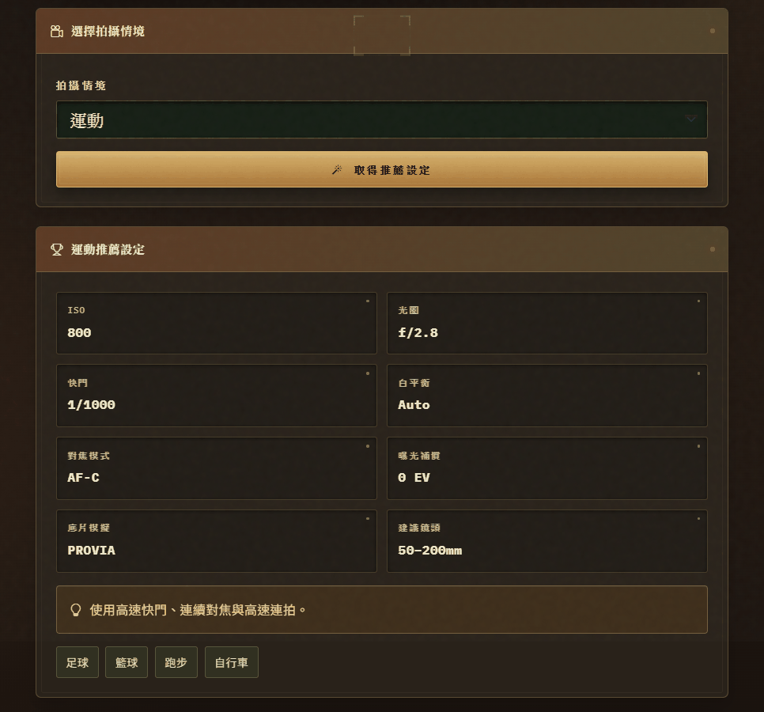
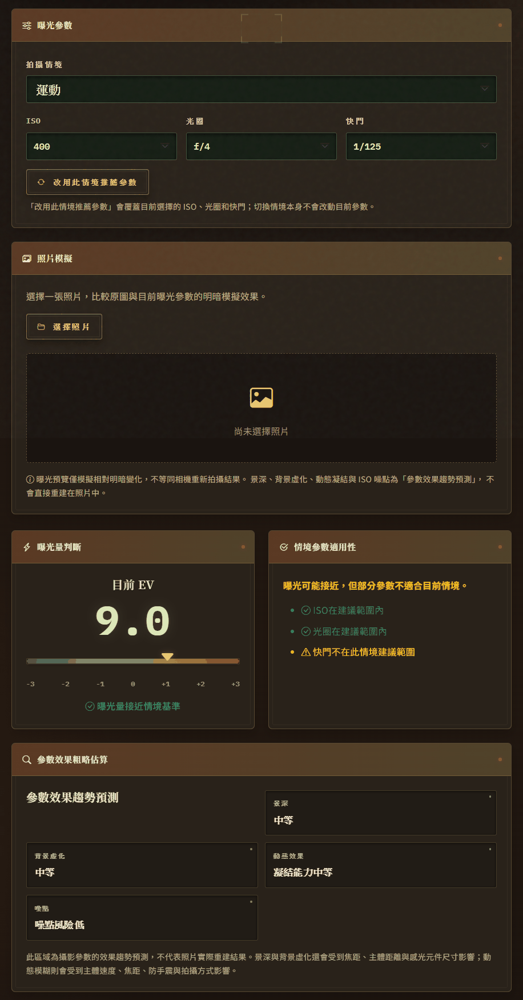
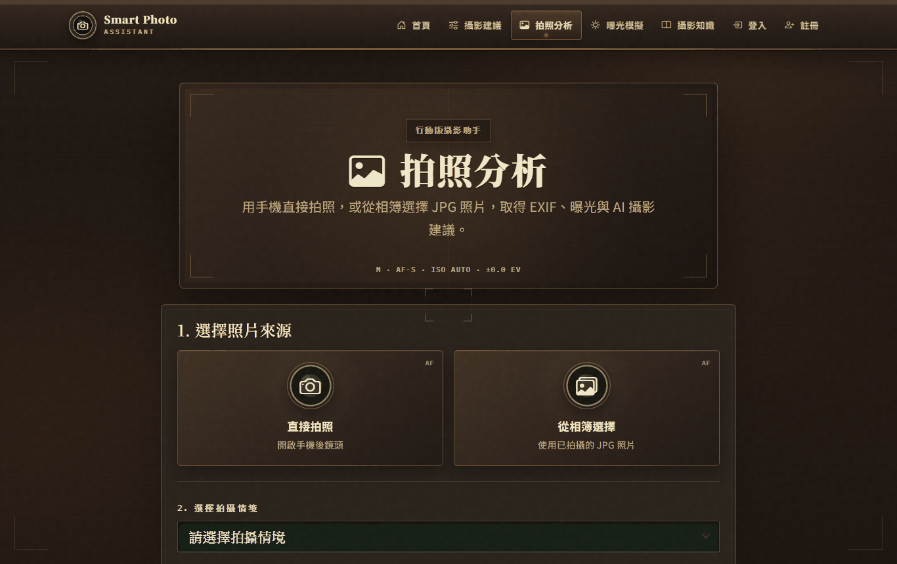
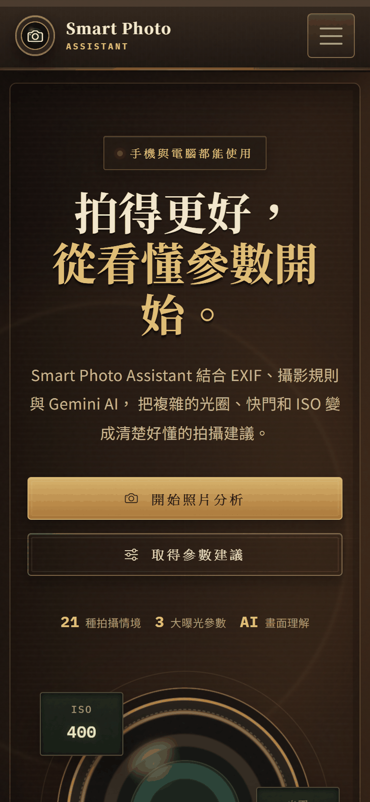
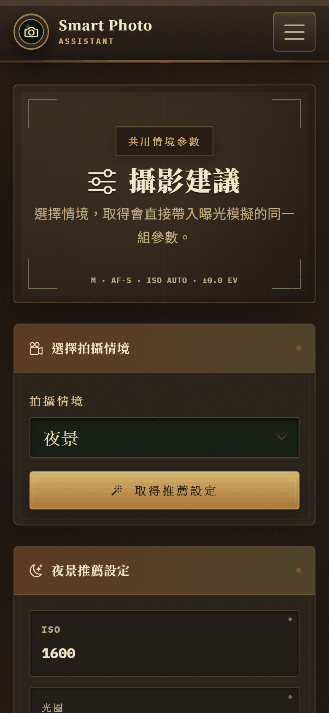

# 📷 Smart Photo Assistant

[繁體中文](README.md) | **English**

> A smart photography assistant that combines **rule-based calculation** with **generative AI explanations**: it recommends camera settings for a shooting scenario, reads a photo's EXIF data to analyze exposure, and uses Gemini to describe the image and teach in plain language.


Midterm project (AIPE04) · Author: 劉秉勳 ([@HSUN0724](https://github.com/HSUN0724))
📑 Presentation slides (Traditional Chinese): [`docs/SmartPhotoAssistant-presentation.pptx`](docs/SmartPhotoAssistant-presentation.pptx)

> The app's interface is in Traditional Chinese.


---

## Screenshots

### Shooting Recommendations — full settings for a chosen scenario
Example for the "Sports" scenario: ISO, aperture, shutter speed, white balance, focus mode, film simulation and suggested lens. The settings can be sent to the exposure simulator in one click, or explained by AI.



### Exposure Simulator — exposure and parameter suitability are judged separately
With ISO 400, f/4 and 1/125 s, the EV is close to the Sports baseline, yet the system still warns that the shutter speed is outside the recommended range for this scenario — preventing motion blur.

<p align="center"></p>

### Photo Analysis — shoot directly with the phone camera or pick from the album



### Mobile

<p align="center">
  
  &nbsp;&nbsp;
  
</p>

---

## Motivation

Beginner photographers often get stuck on "What ISO, aperture and shutter speed should I use here?" and "Why did my shot come out too dark or blurry?"
This project splits photography knowledge into two layers:

- **Deterministic work is done by code**: EXIF parsing, the EV exposure formula, and parameter ranges and adjustment rules for 21 scenarios.
- **Understanding and explaining is done by AI**: Gemini interprets the photo and turns the computed values into easy-to-follow advice — it **never rewrites the parameters** on its own.

## Features

| Module | Description |
| --- | --- |
| 🎯 **Shooting Recommendations** | ISO / aperture / shutter recommendations and limits for 21 scenarios: portrait, landscape, night, sports, sunset, sunrise, food, macro, street, pets, birds, wildlife, concerts, fireworks, beach, mountains, snow, rain, architecture, museums and indoor |
| 🖼️ **Photo Analysis** | Upload a JPG to read its EXIF, compute the EV difference from the scenario baseline and generate per-parameter rule-based feedback; an Adaptive Rule Engine adjusts suggestions to the actual exposure |
| 🤖 **Gemini AI Analysis** | Observations about the image, system settings vs. an AI second opinion, trade-off explanations and tips for the next shot; falls back to built-in explanations when AI is unavailable |
| 🎚️ **Exposure Simulator** | Interactive exposure triangle with live in-browser brightness preview of a photo; exposure and parameter suitability are judged separately (e.g. correct EV but a too-slow shutter for sports still triggers a warning) |
| 📰 **Photography Article Scraper** | Scrapes articles from 鼎愛文化 (DACE), OM Art Studio and Canon Taiwan in parallel, with a 15-minute cache and fallback data |
| 👤 **Accounts & My Photos** | Sign up / log in (hashed passwords), permanently save photos and exposure simulation results; unsaved temporary uploads are deleted automatically after 24 hours |
| 📱 **Mobile Support** | Responsive UI, shoot directly or pick from the album, client-side compression that preserves EXIF; a temporary public HTTPS URL can be created with Cloudflare Quick Tunnel for demos |

### End-to-end Flow

```
Photo Analysis (EXIF + rule analysis + Gemini image analysis)
        │  pass analysis results
        ▼
Shooting Recommendations (scenario settings + AI explanation)
        │  pass scenario and ISO / aperture / shutter
        ▼
Exposure Simulator (adjust settings, live brightness preview, AI explanation)
```

All three pages share `recommendations.py` as the **single source of truth** for scenario parameters, so the frontend never keeps a second copy and the values stay consistent.

## Tech Stack

- **Backend**: Python 3, Flask, Pillow, piexif (EXIF read/write), SQLite (accounts and photos), PyMySQL (optional external parameter database)
- **AI**: Google Gemini (`google-genai` SDK) — multimodal photo analysis and text explanations
- **Scraping**: requests + BeautifulSoup4, parallel fetching with ThreadPoolExecutor
- **Frontend**: Jinja2 templates, Bootstrap 5.3, Bootstrap Icons, vanilla JavaScript (Canvas exposure simulation, client-side JPG compression)
- **Demo deployment**: Cloudflare Quick Tunnel (`start_public.ps1`)

### Exposure Calculation

```python
EV = log2(N² / t) − log2(ISO / 100)     # N = f-number, t = shutter time in seconds
```

Subtracting the scenario's baseline EV from the photo's EV tells how many stops it is over- or under-exposed. Over- and under-exposure use different adjustment orders; fast-moving subjects such as sports and birds keep a high shutter speed first, and suggestions never leave the scenario's parameter range.

## Project Structure

```
SmartPhotoAssistant/
├── app.py                      # Flask app: routes, uploads, EXIF, accounts, APIs
├── recommendations.py          # Parameters for 21 scenarios (single source of truth)
├── adaptive_recommendation.py  # Adaptive Rule Engine: adjusts suggestions to actual exposure
├── analysis.py                 # Rule-based analysis per scenario
├── exposure.py                 # EV calculation and parameter suitability checks
├── ai_analysis.py              # Gemini photo analysis and natural-language explanations
├── article_scraper.py          # Article scraper for three sites (with cache and fallback)
├── database.py                 # SQLite table initialization
├── start_public.ps1            # One-click start + temporary Cloudflare public URL
├── requirements.txt
├── .env.example                # Environment variable template
├── templates/                  # Jinja2 pages
├── static/
│   ├── css/                    # Styles (retro camera theme)
│   ├── js/                     # Upload compression, exposure simulator, recommendation page
│   └── uploads/                # Runtime uploads (not tracked by git)
├── scripts/gemini_test.py      # Gemini API connection test
└── docs/
    ├── SmartPhotoAssistant-presentation.pptx
    ├── public-url-guide.md     # Temporary public URL guide (Chinese)
    ├── changelog/              # Release notes per version (Chinese)
    └── screenshots/            # README screenshots
```

## Getting Started

Requires **Python 3.10 or later**.

```bash
git clone https://github.com/HSUN0724/SmartPhotoAssistant.git
cd SmartPhotoAssistant
python -m venv .venv
```

```powershell
# Windows PowerShell
.venv\Scripts\Activate.ps1
# macOS / Linux: source .venv/bin/activate

python -m pip install -r requirements.txt
cp .env.example .env      # fill in your own GEMINI_API_KEY and SECRET_KEY
python app.py
```

Open <http://127.0.0.1:5000>.

- Without `GEMINI_API_KEY`, recommendations, EXIF analysis and the exposure simulator still work; AI explanations fall back to built-in text.
- MySQL is optional (`USE_DATABASE=false` by default); when disabled, the built-in data in `recommendations.py` is used.
- Test the Gemini connection: `python scripts/gemini_test.py`

### Using a Phone

- **Same Wi-Fi**: find the computer's IPv4 address with `ipconfig`, then open `http://<computer-IP>:5000` on the phone.
- **Different network (short demos)**: put `cloudflared.exe` in the project root and run `.\start_public.ps1`. See [docs/public-url-guide.md](docs/public-url-guide.md).

## Upload Limits

- Photo analysis accepts JPG / JPEG only, up to 10 MB per file (phones downscale to 1920 px on the long edge first)
- Parameter comparison needs ISO, aperture and shutter EXIF; some phones strip EXIF when shooting directly from the browser — the app says so clearly and still offers AI image analysis
- Photos used in the exposure simulator are processed locally in the browser and are not uploaded

## Version History

| Version | Highlights |
| --- | --- |
| v6.0 | Recommendations / photo analysis / exposure simulator linked end-to-end with a single parameter source; Gemini explanations added |
| v6.1 | Original photo EXIF can be passed to the exposure simulator; switch between photo settings and scenario recommendations |
| v6.2 | Temporary Cloudflare public URL, missing-EXIF detection on phones, scenario selection made required |
| v6.4 | Bootstrap Icons across the site, photo brightness simulation |
| final | Sign up / log in, My Photos, 24-hour auto cleanup of temporary uploads, Adaptive Rule Engine |

See [`docs/changelog/`](docs/changelog/) for details (in Chinese).
