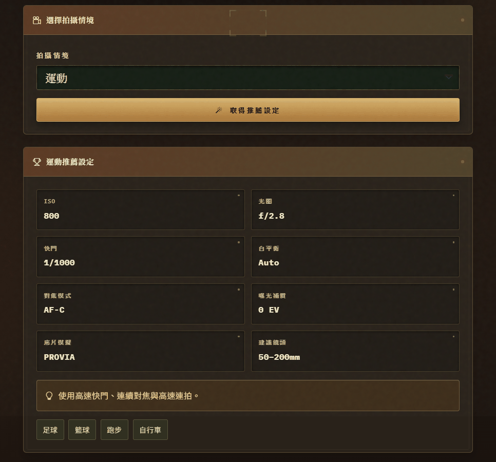
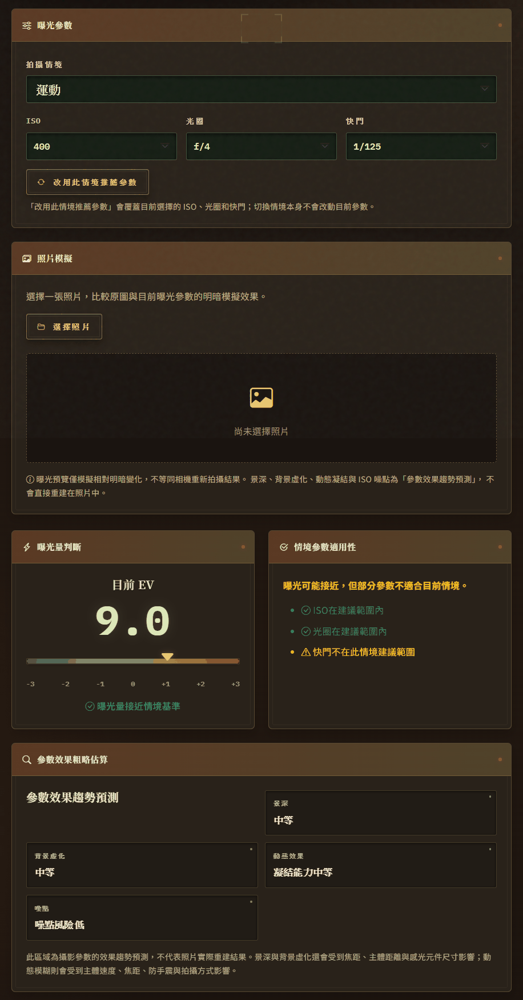
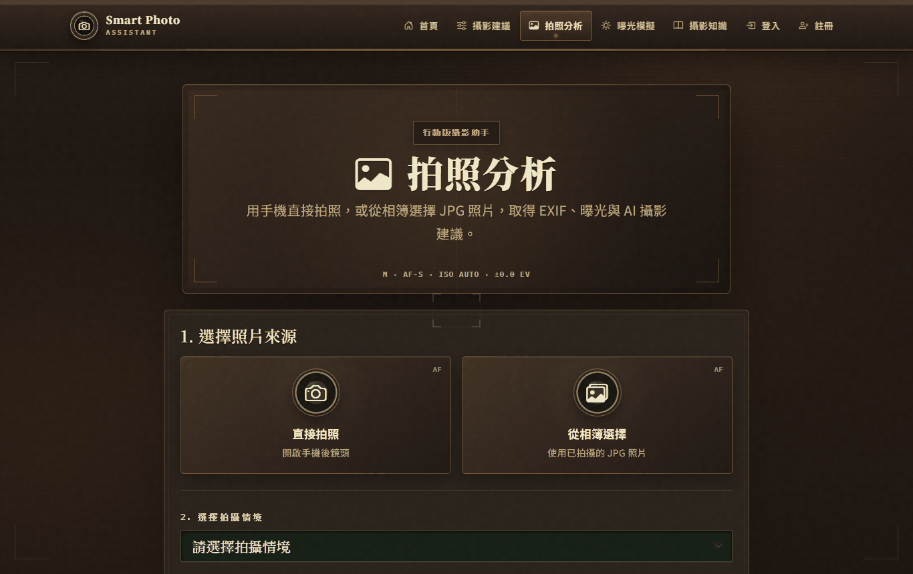
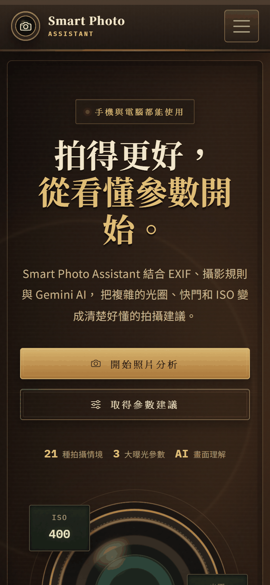
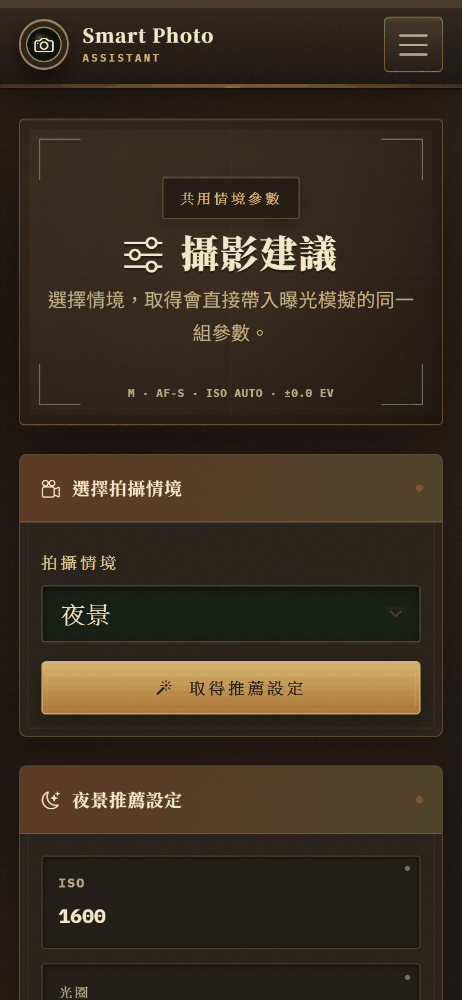

# 📷 Smart Photo Assistant — AI 智慧攝影助手

> 結合**規則計算**與**生成式 AI 解說**的智慧攝影助理：依拍攝情境推薦相機參數、讀取照片 EXIF 分析曝光，並以 Gemini 提供畫面分析與自然語言教學。


期中專題作品（AIPE04）・作者：劉秉勳 ([@HSUN0724](https://github.com/HSUN0724))
📑 專題簡報：[`docs/SmartPhotoAssistant-presentation.pptx`](docs/SmartPhotoAssistant-presentation.pptx)


---

## 畫面截圖

### 攝影建議 — 選擇情境取得完整參數
以「運動」情境為例：ISO、光圈、快門、白平衡、對焦模式、底片模擬與建議鏡頭，並可一鍵帶入曝光模擬或請 AI 解釋。



### 曝光模擬 — 曝光量與參數適用性分開判斷
ISO 400、f/4、1/125 的 EV 與運動情境基準相近，但系統仍警告「快門不在此情境建議範圍」，避免拍出動態模糊。

<p align="center"></p>

### 拍照分析 — 手機直接拍照或從相簿選擇



### 行動裝置

<p align="center">
  
  &nbsp;&nbsp;
  
</p>

---

## 專案動機

初學攝影的人常卡在「這個場景 ISO、光圈、快門該怎麼設？」以及「為什麼我拍出來太暗／糊掉？」。
本專案把攝影知識拆成兩層：

- **確定性的部分交給程式**：EXIF 讀取、EV 曝光公式、21 種情境的參數範圍與調整規則。
- **需要理解與表達的部分交給 AI**：Gemini 負責看懂照片畫面，並把程式算出的數值解釋成好懂的建議，**不會自行改寫參數**。

## 主要功能

| 模組 | 說明 |
| --- | --- |
| 🎯 **攝影建議** | 21 種拍攝情境（人像、風景、夜景、運動、夕陽、日出、美食、微距、街拍、寵物、鳥類、野生動物、演唱會、煙火、海灘、山景、雪景、雨天、建築、博物館、室內）各自的 ISO／光圈／快門推薦與上下限 |
| 🖼️ **拍照分析** | 上傳 JPG 讀取 EXIF，計算與情境基準的 EV 差異，產生逐項規則分析；Adaptive Rule Engine 依實際曝光動態調整建議 |
| 🤖 **Gemini AI 分析** | 照片畫面觀察、系統方案 vs. AI 第二意見、取捨說明與下次拍攝建議；AI 無法使用時自動改用內建說明 |
| 🎚️ **曝光模擬器** | 曝光三角互動調整，在瀏覽器即時模擬照片明暗；「曝光量」與「參數適用性」分開判斷（例：EV 正確但運動快門太慢仍會警告） |
| 📰 **攝影文章爬蟲** | 平行爬取鼎愛文化、OM Art Studio、Canon 台灣的攝影文章，15 分鐘快取並具備備援資料 |
| 👤 **會員與我的照片** | 註冊／登入（密碼雜湊）、永久保存照片與曝光模擬結果；未保存的暫存照片 24 小時後自動清除 |
| 📱 **行動裝置支援** | 響應式介面、手機直接拍照或從相簿選圖、上傳前自動壓縮並保留 EXIF；可用 Cloudflare Quick Tunnel 產生臨時 HTTPS 網址展示 |

### 完整串接流程

```
拍照分析（EXIF + 規則分析 + Gemini 畫面分析）
        │  帶入分析結果
        ▼
攝影建議（情境推薦參數 + AI 解釋）
        │  帶入情境與 ISO／光圈／快門
        ▼
曝光模擬（調整參數、即時預覽明暗、AI 解釋）
```

三個頁面共用 `recommendations.py` 作為**唯一的情境參數資料來源**，前端不再維護第二份設定，確保數值一致。

## 技術架構

- **後端**：Python 3、Flask、Pillow、piexif（EXIF 讀寫）、SQLite（會員與照片）、PyMySQL（選用的外部參數資料庫）
- **AI**：Google Gemini（`google-genai` SDK）— 多模態照片分析與文字解釋
- **爬蟲**：requests + BeautifulSoup4，ThreadPoolExecutor 平行抓取
- **前端**：Jinja2 樣板、Bootstrap 5.3、Bootstrap Icons、原生 JavaScript（Canvas 曝光模擬、前端 JPG 壓縮）
- **部署展示**：Cloudflare Quick Tunnel（`start_public.ps1`）

### 曝光計算核心

```python
EV = log2(N² / t) − log2(ISO / 100)     # N = 光圈值，t = 快門秒數
```

照片的 EV 與情境基準 EV 相減，得到「偏亮／偏暗」幾格；偏暗與偏亮使用不同的調整順序，運動、鳥類等動態題材會優先保留高速快門，且建議值不會超出該情境的參數範圍。

## 專案結構

```
SmartPhotoAssistant/
├── app.py                      # Flask 主程式：路由、上傳、EXIF、會員、API
├── recommendations.py          # 21 種情境參數（唯一資料來源）
├── adaptive_recommendation.py  # Adaptive Rule Engine：依實際曝光動態調整建議
├── analysis.py                 # 各情境的規則式分析
├── exposure.py                 # EV 曝光計算與參數適用性評估
├── ai_analysis.py              # Gemini 照片分析與自然語言解釋
├── article_scraper.py          # 三站攝影文章爬蟲（含快取與備援）
├── database.py                 # SQLite 資料表初始化
├── start_public.ps1            # 一鍵啟動 + Cloudflare 臨時公開網址
├── requirements.txt
├── .env.example                # 環境變數範本
├── templates/                  # Jinja2 頁面
├── static/
│   ├── css/                    # 介面樣式（復古相機主題）
│   ├── js/                     # 上傳壓縮、曝光模擬、建議頁互動
│   └── uploads/                # 執行時的上傳照片（不納入版控）
├── scripts/gemini_test.py      # Gemini API 連線測試
└── docs/
    ├── SmartPhotoAssistant-presentation.pptx
    ├── public-url-guide.md     # 臨時公開網址操作說明
    ├── changelog/              # 各版本修正紀錄
    └── screenshots/            # README 截圖
```

## 安裝與執行

需要 **Python 3.10 以上**。

```bash
git clone https://github.com/HSUN0724/SmartPhotoAssistant.git
cd SmartPhotoAssistant
python -m venv .venv
```

```powershell
# Windows PowerShell
.venv\Scripts\Activate.ps1
# macOS / Linux：source .venv/bin/activate

python -m pip install -r requirements.txt
cp .env.example .env      # 填入自己的 GEMINI_API_KEY 與 SECRET_KEY
python app.py
```

開啟 <http://127.0.0.1:5000>。

- 未設定 `GEMINI_API_KEY` 時，參數推薦、EXIF 分析與曝光模擬仍可正常使用，AI 解釋會改用內建說明。
- MySQL 為選用功能（`USE_DATABASE=false` 為預設），未啟用時使用 `recommendations.py` 內建資料。
- 測試 Gemini 連線：`python scripts/gemini_test.py`

### 手機連線

- **同一個 Wi-Fi**：以 `ipconfig` 查電腦 IPv4，手機開啟 `http://<電腦IP>:5000`。
- **不同網路（短暫展示）**：將 `cloudflared.exe` 放在專案根目錄後執行 `.\start_public.ps1`，詳見 [docs/public-url-guide.md](docs/public-url-guide.md)。

## 上傳限制

- 照片分析僅接受 JPG／JPEG，單檔最大 10 MB（手機端會先縮至最長邊 1920 px）
- 照片需含 ISO、光圈與快門 EXIF 才能進行參數比較；部分手機「直接拍照」會移除 EXIF，系統會明確提示並保留 AI 畫面分析
- 曝光模擬的照片只在瀏覽器本機處理，不會另外上傳

## 版本歷程

| 版本 | 重點 |
| --- | --- |
| v6.0 | 攝影建議／照片分析／曝光模擬三段串接，共用單一參數來源；加入 Gemini 解釋 |
| v6.1 | 照片原始 EXIF 可完整帶入曝光模擬，可在原始參數與情境推薦間切換 |
| v6.2 | Cloudflare 臨時公開網址、手機 EXIF 缺失偵測、情境選單改為必選 |
| v6.4 | 全站改用 Bootstrap Icons、加入照片明暗模擬 |
| final | 會員註冊登入、我的照片、暫存照片 24 小時自動清除、Adaptive Rule Engine |

詳細內容見 [`docs/changelog/`](docs/changelog/)。
