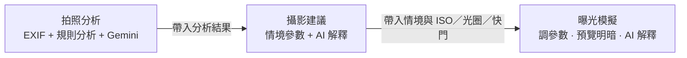
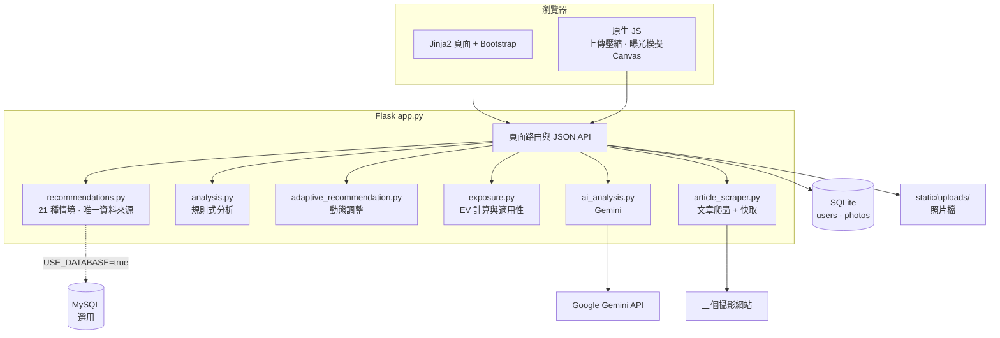
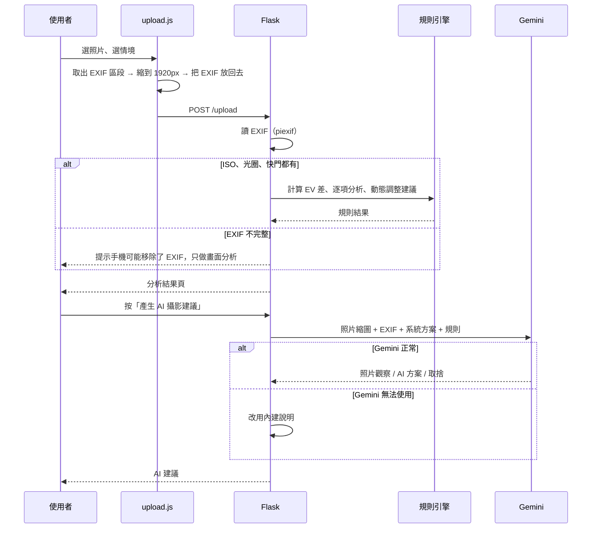

# Smart Photo Assistant 專案總覽

整理日期：2026-11-13

Smart Photo Assistant 是一個給攝影初學者用的網站：選拍攝情境就給相機參數，上傳照片就讀 EXIF 告訴你曝光差多少、該怎麼調，並用 Google Gemini 看照片、用白話解釋。

這份文件說明專案要解決什麼問題、做了哪些功能、系統怎麼組成、為什麼這樣選、做了哪些取捨，以及怎麼開發。安裝與畫面截圖見 [README](../README.md)。

| 項目 | 內容 |
| --- | --- |
| 類型 | 個人期中專題（AIPE04） |
| 技術 | Python、Flask、Pillow、piexif、SQLite、Google Gemini、Bootstrap 5、原生 JavaScript |
| 規模 | 後端約 3,200 行 Python、前端約 1,750 行 JavaScript、9 個頁面樣板 |
| 版本 | v5 → v6.0 → v6.1 → v6.2 → v6.4 → final |

---

## 一、要解決的問題

### 初學者遇到什麼困難

1. **不知道參數怎麼設。** 拍運動、夜景、人像時，ISO、光圈、快門各該設多少？網路文章給的是一段文字，不是可以直接照著設的數字。
2. **拍壞了不知道為什麼。** 照片太暗或糊掉，不知道是哪一個參數造成的，也不知道下次要調哪個。
3. **曝光三角很抽象。** 「光圈大一格、快門要快一格」這種關係，光看文字很難體會。
4. **問 AI 會得到不一致的答案。** 直接問聊天機器人，同樣的問題每次給的數字可能不同，甚至算錯。

### 解法的核心想法

把攝影知識拆成兩層，各用適合的方法處理：

| 層 | 交給誰 | 例子 |
| --- | --- | --- |
| **確定性的計算** | 程式 | 讀 EXIF、EV 曝光公式、21 種情境的參數範圍、調整規則 |
| **需要理解與表達的部分** | Gemini | 看懂照片畫面、把程式算出的數字解釋成白話建議 |

AI **只能解釋程式算出來的數值，不能自己改寫參數**。這樣數字永遠一致、可以驗證，AI 負責的是「讓人看得懂」。

---

## 二、主要功能

| 功能 | 做什麼 | 用到的技術 |
| --- | --- | --- |
| 攝影建議 | 21 種情境（人像、夜景、運動、鳥類、煙火……）各給 ISO／光圈／快門、白平衡、對焦模式、建議鏡頭與參數上下限 | `recommendations.py` |
| 拍照分析 | 上傳 JPG，讀 EXIF，算出和情境基準差幾格 EV，逐項說明哪裡不對 | Pillow、piexif、`analysis.py` |
| Adaptive Rule Engine | 依照片實際曝光動態調整建議；動態題材優先保留高速快門，再用 ISO 補回曝光 | `adaptive_recommendation.py` |
| Gemini 照片分析 | 觀察畫面主體與光線，給出「系統方案 vs. AI 第二意見」與取捨說明 | `google-genai`、`ai_analysis.py` |
| 曝光模擬器 | 調整曝光三角，在瀏覽器即時預覽照片變亮或變暗；**曝光量**與**參數適用性**分開判斷 | Canvas、CSS filter、`exposure.py` |
| 攝影文章 | 平行抓三個攝影網站的文章，快取 15 分鐘，抓不到時顯示備援資料 | requests、BeautifulSoup、ThreadPoolExecutor |
| 會員與我的照片 | 註冊登入、永久保存照片與模擬結果；未保存的照片 24 小時後自動清除 | SQLite、werkzeug 密碼雜湊 |
| 行動裝置 | 手機直接拍照或從相簿選、上傳前壓縮並保留 EXIF；可用 Cloudflare Tunnel 產生臨時 HTTPS 網址 | 原生 JS、`start_public.ps1` |

### 三個頁面串成一條流程



使用者可以從自己的照片出發，看到建議，再到模擬器裡試調參數，看看結果會怎麼變。

---

## 三、系統架構



### 一次照片分析的流程



### 曝光計算核心

```python
EV = log2(N² / t) − log2(ISO / 100)   # N = 光圈值，t = 快門秒數
```

照片的 EV 和情境基準 EV 相減，就知道偏亮或偏暗幾格。`evaluate_exposure()` 另外檢查 ISO、光圈、快門是否落在情境的建議範圍內，兩者分開回報。

---

## 四、技術選擇與原因

| 選擇 | 原因 | 考慮過的替代方案 |
| --- | --- | --- |
| **Flask + Jinja2** | 專題規模小、頁面以表單與結果頁為主，Flask 一個檔案就能跑；Jinja2 直接渲染不用另寫前端框架 | FastAPI + React：前後端分離對這個規模太重 |
| **Pillow + piexif** | Pillow 處理圖片縮放；piexif 能完整讀出 ISO、光圈、快門的分數格式（例如 `1/125`） | 只用 Pillow：EXIF 欄位較難完整解析 |
| **規則引擎（純 Python）** | 曝光是物理公式，規則可預測、可驗證、可解釋 | 讓 LLM 直接給參數：每次答案可能不同，也可能算錯 |
| **Google Gemini（多模態）** | 能同時看圖和讀文字；免費額度足夠展示；`google-genai` SDK 用法簡單 | 只用文字模型：看不到照片內容 |
| **SQLite** | 不用另外安裝資料庫，下載即可執行，適合繳交與展示 | MySQL：保留為選用的外部參數資料庫，但預設不需要 |
| **原生 JavaScript + Canvas** | 曝光預覽只要調亮度，CSS `brightness()` 與 Canvas 就做得到，照片不必再上傳 | 後端產生預覽圖：每調一次參數就要來回一次伺服器 |
| **Bootstrap 5** | 快速做出響應式、手機可用的介面 | 手刻 CSS：花太多時間在版面 |
| **Cloudflare Quick Tunnel** | 一個指令產生臨時 HTTPS 網址，手機用行動網路也能連，展示時不用部署 | 雲端部署：展示用途不需要長期維運 |

---

## 五、工程上的取捨

| 議題 | 選擇 | 換來什麼 | 付出什麼 |
| --- | --- | --- | --- |
| AI 的角色 | AI 只解釋、不改參數；`ai_analysis.py` 的 prompt 明確禁止自行新增或改寫數值 | 數字一致、可驗證，AI 錯了也不會影響推薦 | AI 的發揮空間受限 |
| AI 第二意見 | 照片分析允許 AI 提出另一組參數，但必須說明取捨 | 使用者看到不同角度，學到「為什麼」 | 兩套方案可能讓初學者困惑，需要清楚標示「系統方案」與「AI 參考方案」 |
| AI 失敗時 | Gemini 無法使用時改用內建說明 | 核心功能永遠可用，展示不會因網路出包 | 內建說明較制式 |
| 情境參數的來源 | `recommendations.py` 是**唯一資料來源**，三個頁面共用，前端不再存一份 | 數值永遠一致（v6.0 前曾經不一致） | 前端每次要從後端取參數 |
| 曝光量 vs. 參數適用性 | 分開判斷 | EV 正確但快門太慢（運動情境 1/125）仍會被警告，避免動態模糊 | 結果頁要解釋兩種狀態 |
| 動態題材 | 優先保留高速快門，再用 ISO 補曝光 | 先確保主體不糊 | 可能增加雜訊 |
| 手機拍照的 EXIF | 有些手機瀏覽器拍照會移除 EXIF；系統偵測並提示，只有三要素齊全才做曝光比較，但仍做 AI 畫面分析 | 不會用缺漏資料算出錯誤結論，也不會編造參數 | 部分照片無法做參數比較 |
| 上傳前壓縮 | 前端先取出 EXIF 區段、縮到 1920px、再把 EXIF（方向設為正）放回去 | 上傳變快、伺服器負擔小，EXIF 不會在壓縮時遺失 | 前端要自己處理 JPEG 位元組 |
| 曝光模擬在瀏覽器做 | 用 `2^EV` 換算亮度，CSS／Canvas 調整 | 即時、不耗伺服器，照片不必再上傳 | 只是近似的亮度模擬，不是真實的感光元件模型 |
| 照片保存 | 預設 24 小時暫存，使用者按「保存」才永久保留 | 隱私與磁碟空間都比較安心 | 清理在每次上傳時順便執行，沒有獨立排程 |
| 文章爬蟲 | 三站平行抓、8 秒逾時、快取 15 分鐘、失敗用備援資料 | 頁面不會被慢網站拖住 | 文章最多晚 15 分鐘更新 |
| 版本管理 | 每個大版本複製一份新資料夾，舊版不動 | 隨時有可展示的穩定版 | 版本之間的差異要靠 changelog 對照 |

---

## 六、開發方式

### 以「穩定版 + 新版」的方式迭代

每個版本都從上一個穩定版複製出新資料夾再修改（例如 v6.1 由 `complete-v6-ai-integrated` 複製而來），確保任何時候都有一個能展示的版本。每版的改動、測試步驟與「本版刻意不處理的項目」寫在 [`changelog/`](./changelog/)。

| 版本 | 重點 |
| --- | --- |
| v6.0 | 三個頁面串成一條流程，共用單一參數來源；加入 Gemini 解釋 |
| v6.1 | 照片原始 EXIF 可完整帶入曝光模擬，可在原始參數與情境推薦間切換 |
| v6.2 | Cloudflare 臨時公開網址、手機 EXIF 缺失偵測、情境選單改為必選 |
| v6.4 | 全站改用 Bootstrap Icons、加入照片明暗模擬 |
| final | 會員、我的照片、暫存照片 24 小時清除、Adaptive Rule Engine |

### 用情境測試驗證

每版 changelog 都列出手動測試步驟。例如 v6.0 的展示重點：把運動情境的快門改成 `1/125`，確認即使曝光量接近基準，系統仍會警告快門不適合凝結動作。

---

## 七、專案結構

```
SmartPhotoAssistant/
├── app.py                      # Flask 主程式：路由、上傳、EXIF、會員、API
├── recommendations.py          # 21 種情境參數（唯一資料來源）
├── adaptive_recommendation.py  # Adaptive Rule Engine：依實際曝光動態調整
├── analysis.py                 # 各情境的規則式分析
├── exposure.py                 # EV 計算與參數適用性評估
├── ai_analysis.py              # Gemini 照片分析與文字解釋
├── article_scraper.py          # 三站攝影文章爬蟲（平行、快取、備援）
├── database.py                 # SQLite 資料表初始化與欄位補齊
├── start_public.ps1            # 一鍵啟動 + Cloudflare 臨時公開網址
├── templates/                  # Jinja2 頁面（首頁、建議、分析、模擬、文章、會員、我的照片）
├── static/
│   ├── css/                    # 復古相機主題樣式
│   ├── js/                     # upload.js（壓縮與 EXIF）、exposure2.js（模擬）、recommend.js
│   └── uploads/                # 執行時的照片（不進版控）
├── scripts/gemini_test.py      # Gemini 連線測試
└── docs/                       # 簡報、公開網址說明、changelog、截圖、本文件
```

| 模組 | 依賴 | 說明 |
| --- | --- | --- |
| `recommendations.py` | 無 | 最底層的資料，其他模組都從這裡取情境參數 |
| `exposure.py`、`adaptive_recommendation.py`、`analysis.py` | `recommendations.py` | 純計算，不碰網路與資料庫 |
| `ai_analysis.py` | Gemini | 只接收已算好的事實 |
| `app.py` | 以上全部 + SQLite | 路由與流程組裝 |

---

## 八、已知限制與後續方向

| 項目 | 現況 | 可能的方向 |
| --- | --- | --- |
| 自動化測試 | 目前靠 changelog 的手動測試步驟 | 先為 `exposure.py`、`adaptive_recommendation.py` 這類純函式加 pytest |
| `app.py` 偏大 | 約 1,400 行，路由、EXIF、會員都在同一檔 | 用 Flask Blueprint 拆成分析、會員、API 等模組 |
| EV 公式重複 | `exposure.py`、`recommendations.py`、`adaptive_recommendation.py` 各有一份 | 統一由一個模組提供 |
| 暫存清理 | 只在上傳時順便執行 | 改成排程任務 |
| 曝光模擬 | 以亮度近似，不模擬雜訊、景深、動態模糊 | 加入景深與快門模糊的示意 |
| 部署 | 本機執行 + 臨時 Tunnel，適合展示 | 若要長期上線：WSGI 伺服器（gunicorn／waitress）、HTTPS、正式資料庫 |
